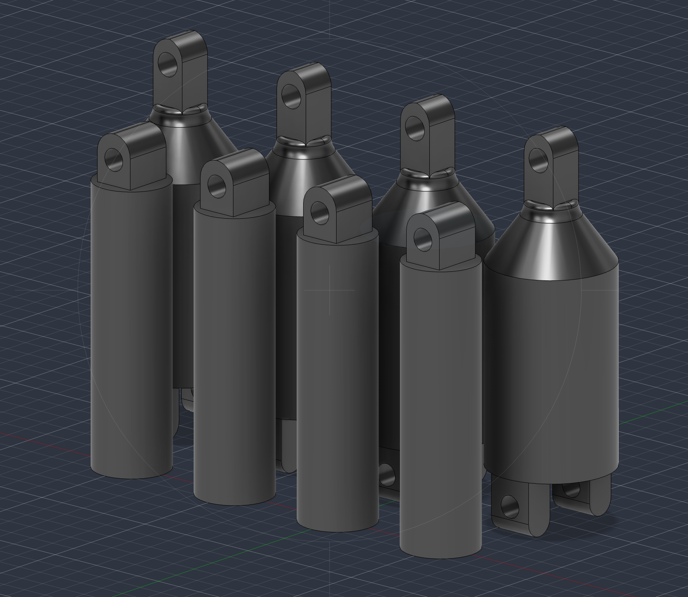

# Day 3 — Arm redesign, shoulders and parts list

I continued working on the mechanical design in Fusion 360. After looking at the arms from Day 2, I realised they were too short for the linkage arrangement I had in mind, so I made a longer version rather than trying to work around the original dimensions.

I also designed the shoulder pieces that will connect the mechanism to the servo arms. The updated parts have mounting holes for the joints, and the CAD model helped me check the shapes before moving on to a physical build.

*Figure 1 — Revised arm and shoulder designs in Fusion 360. The taller tapered parts are the shoulder components; the shorter cylindrical parts show the updated arm design.*

I put together a **bill of materials (BOM)** and ordered the components needed for the build. This was mainly a design and procurement session; I hadn't assembled or tested the full linkage yet.

**Next:** Wire up the BMI160 and PCA9685 and test them separately.
